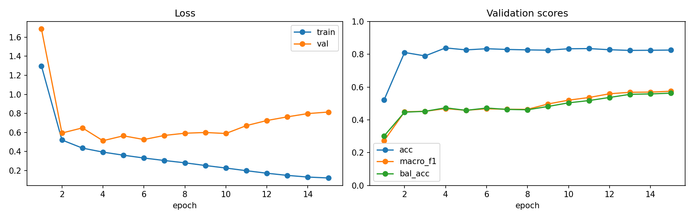
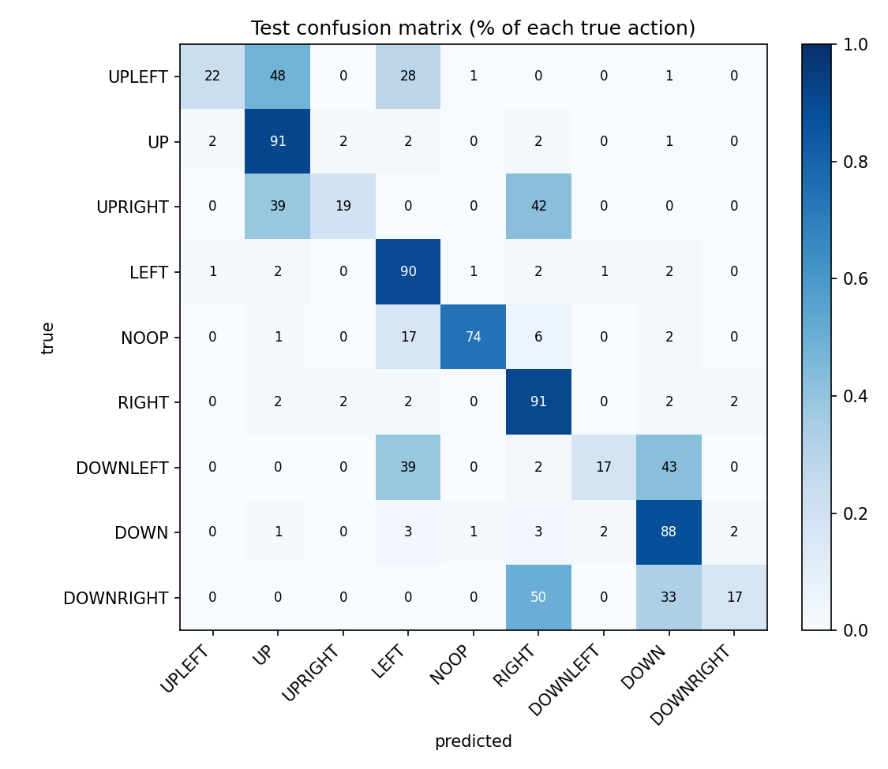
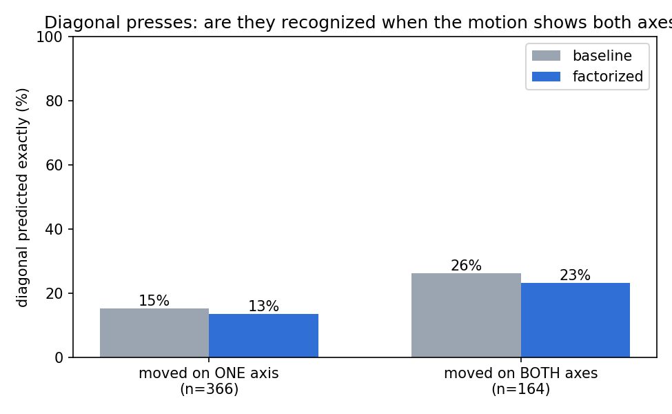

# Inverse Dynamics Model for Ms. Pac-Man

A from-scratch reimplementation of the **inverse dynamics model (IDM)** from OpenAI's
[Video Pre-Training (VPT)](https://arxiv.org/abs/2206.11795), trained on human Ms. Pac-Man gameplay
from [Atari-HEAD](https://zenodo.org/record/3451402). The model watches 16 frames of gameplay and
predicts which joystick action the player pressed.

Started from [vpt-idm-clean](https://github.com/chiaravongerlach/vpt-idm-clean). Along the way I found
and fixed a label bug and a data leak, ran a fair version of its main experiment, and tracked Pac-Man
pixel by pixel to explain why some actions can't be learned.

## Key findings

1. **The original labels were off by one.** Atari-HEAD uses the full 18-action emulator numbering
   (`2 = UP, 3 = RIGHT`); the original code assumed the short Ms. Pac-Man list (`1 = UP, 2 = RIGHT`).
   Every UP was trained as RIGHT. Raw ID 1, which the original code called "UP", appears **4 times
   in 388,602 frames**.
2. **The original split leaked.** Neighboring clips share 15 of 16 frames, and a random split put
   near-copies in train and test. Here, whole play sessions go to train, val or test.
3. **Splitting the action into horizontal + vertical questions doesn't help.** With only the head
   and loss changed, the factorized model ties the 9-way model.
4. **Most diagonal presses are invisible.** Tracking Pac-Man shows that 68% of diagonal presses
   move her along only one axis, so the frames look identical to a cardinal press. When this happens,
   the model picks the half she actually moved on 5–6× more often than the other half.

## Results

Test set: 3 held-out play sessions (13,258 clips) the model never saw during training or model selection.

| Model | Accuracy | Macro-F1 | Balanced acc. | Horizontal half | Vertical half |
| --- | --- | --- | --- | --- | --- |
| Always guess LEFT | 28.1% | 0.049 | 0.111 | — | — |
| 9-way IDM | 86.2% | 0.574 | 0.567 | 90.2% | 91.9% |
| Factorized IDM | 86.9% | 0.566 | 0.561 | 90.7% | 92.7% |

Per-action F1 (9-way): cardinal directions 0.89–0.90, NOOP 0.81, each diagonal 0.17–0.23.
Macro-F1 is the headline metric because 90% of frames are cardinal moves, so accuracy alone hides the diagonals.

| | |
| --- | --- |
|  |  |

### Why diagonals are hard

When the 9-way model misses a diagonal, ~80% of the time it predicts one of the diagonal's two halves
(UPLEFT → UP or LEFT). Tracking Pac-Man's position (she's drawn in RGB 210, 164, 74) after each press:

| Diagonal presses (537 test clips) | Share |
| --- | --- |
| Moved on one axis only | 68% |
| Moved on both axes | 31% |
| Didn't move | 1% |

| One-axis diagonal presses | 9-way | Factorized |
| --- | --- | --- |
| Predicted the half she moved on | 70% | 74% |
| Predicted the half with no visible effect | 14% | 11% |

Even both-axis motion is ambiguous: turning a corner under an ordinary press also moves her on both axes,
and cardinal presses are ~20× more common. Only 21% of clips with both-axis motion were diagonal presses.



The same applies to NOOP: after a NOOP she stands still 94% of the time, but so does 17% of LEFT presses
(pushing into a wall), so "no press" and "LEFT into a wall" look the same.

## Method

- **Data:** Atari-HEAD Ms. Pac-Man, 22 sessions, 388,602 frames.
- **Clips:** 16 grayscale 84×84 frames, every 4th raw frame, labeled with the action at the middle
  frame (index 8). 96,826 clips; clips spanning a game-over are dropped.
- **Split by session:** 16 / 3 / 3 sessions → 70,362 / 13,206 / 13,258 clips.
- **Labels:** 9 classes (NOOP, 4 directions, 4 diagonals) laid out as a 3×3 joystick grid
  (`class = 3*v + h`), built from action **names** in `action_enums.txt`. FIRE is folded into its direction.
- **Model (7.9M params):** 3D conv over time → per-frame 2D CNN → 2-layer transformer with no causal mask
  (it sees past and future frames) → MLP head on the middle frame.
- **Training:** AdamW (lr 1e-4, weight decay 1e-5), cosine schedule, 15 epochs, batch 32, mixed precision,
  seed 42, free Colab T4 (~2 h per run). Best epoch chosen by validation macro-F1.
- **Factorized variant:** same backbone, two 3-way heads (L/none/R and U/none/D),
  loss = CE(horizontal) + CE(vertical). Nothing else changed.

## Repository layout

```
notebooks/
  01_explore_data.ipynb      download Atari-HEAD, decode action IDs, class counts
  02_build_clips.ipynb       frames -> 16-frame clips, session-level split
  03_model.ipynb             model walkthrough, sanity checks (loss ≈ ln 9, overfit one batch)
  04_train_and_test.ipynb    9-way baseline: train on Colab, score once on test
  05_factorized.ipynb        factorized model, side-by-side comparison
  06_motion_analysis.ipynb   track Pac-Man to test whether diagonals are visible
src/
  labels.py    action-name-based label mapping
  data.py      PyTorch Dataset over the stored frames
  model.py     IDM backbone, 9-way and factorized heads
  train.py     shared training / evaluation loop
figures/       plots used above and in the write-up
results/       metrics (JSON), test-set predictions and motion measurements
notes.md       running lab notebook
```

## Reproduce

```bash
pip install -r requirements.txt
```

1. Run notebooks **01 → 03** locally. They download ~5 GB and write `data/processed/` (~2.7 GB).
2. Upload `src/` and `data/processed/` to Google Drive under `pacman-idm/`, then run **04** and **05**
   on Colab with a T4 GPU (set `QUICK = False` after a quick test run).
3. Download `test_preds.npz` into `results/` and run **06** locally.

## Limitations

- One seed per model; the 9-way vs factorized gap is within single-seed noise.
- The leak's effect on the original score isn't isolated (that needs a random-split run with correct labels).
- Most sessions are from one player, so the test set is new games, not new players.
- Motion analysis uses an 8-frame window and a 2-pixel threshold.

## References

- Baker et al. (2022), [Video PreTraining (VPT)](https://arxiv.org/abs/2206.11795)
- Zhang et al., [Atari-HEAD](https://zenodo.org/record/3451402)